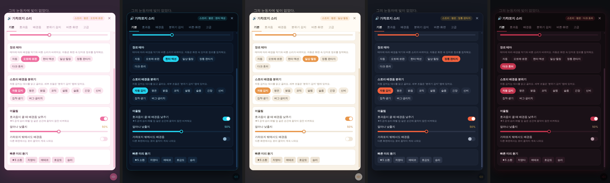
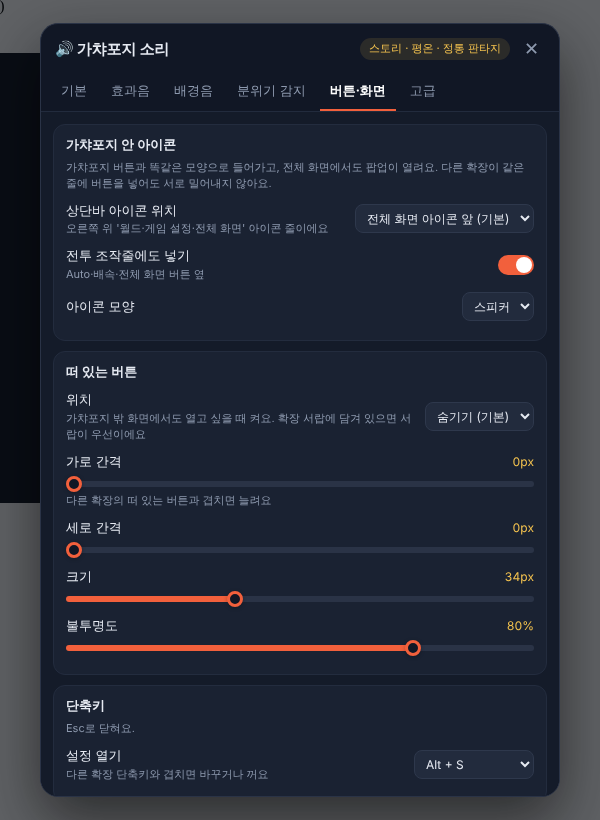

# 🔊 Gacha Forge Sound

[마리나라 엔진(Marinara Engine)](https://github.com/Pasta-Devs/Marinara-Engine)의 **가챠포지(Gacha Forge)** 에 게임 같은 효과음과 배경음을 붙이는 개인 확장입니다.

- 효과음 58종, 배경음 상황 12가지
- 장르 테마 7종: 오토메·로판 / 헌터·액션 / 일상·힐링 / 정통 판타지 / 동양풍 / 아이돌·연예계 / 다크·호러
- 소리는 전부 코드로 실시간 합성합니다. 외부 음원을 받지 않아서 저작권 걱정이 없습니다.
- 원하는 소리는 내 음악·효과음 파일로 바꿀 수 있습니다.

## 데모

**배경음** (각 30초 안팎, 듣기 좋게 음량을 맞춤)

| 테마 | 로비 | 전투 |
|---|---|---|
| 오토메·로판 | [로비](docs/demos/bgm-otome.mp3) | [전투](docs/demos/battle-otome.mp3) |
| 헌터·액션 | [로비](docs/demos/bgm-hunter.mp3) | [전투](docs/demos/battle-hunter.mp3) |
| 일상·힐링 | [로비](docs/demos/bgm-daily.mp3) | [전투](docs/demos/battle-daily.mp3) |
| 정통 판타지 | [로비](docs/demos/bgm-fantasy.mp3) | [전투](docs/demos/battle-fantasy.mp3) |
| 동양풍 (무협·사극) | [로비](docs/demos/bgm-oriental.mp3) | [전투](docs/demos/battle-oriental.mp3) |
| 아이돌·연예계 | [로비](docs/demos/bgm-idol.mp3) | [전투](docs/demos/battle-idol.mp3) |
| 다크·호러 | [로비](docs/demos/bgm-dark.mp3) | [전투](docs/demos/battle-dark.mp3) |

**효과음** (로비 → 버튼 → ★5 공개 → 치명타 → 에테르 → 승리, 17초): [오토메](docs/demos/otome.mp3) · [헌터](docs/demos/hunter.mp3) · [일상](docs/demos/daily.mp3) · [판타지](docs/demos/fantasy.mp3) · [동양풍](docs/demos/oriental.mp3) · [다크](docs/demos/dark.mp3)

## 설치

1. 마리나라 서버의 `.env`에 `ENABLE_EXTERNAL_EXTENSIONS=true`를 넣습니다.
2. **설정 → 고급 → Danger Zone**에서 **Allow third-party extension imports**를 켭니다.
3. **설정 → Addons → External Extensions**에서 이 저장소를 연결하거나, 저장소를 내려받아 폴더째 가져옵니다.
4. 코드를 확인하고 **Review and Run**으로 승인합니다.

> PC 밖(폰·아이패드·원격)에서 확장을 관리하려면 서버 `.env`에 `ADMIN_SECRET`을 정하고, 같은 값을 **설정 → 고급 → Admin Access**에 넣어야 합니다.

### 권한 안내

이 확장은 `full_page_access` 권한을 씁니다. 가챠포지 화면의 연출(소환·전투·대사)을 감지하고, 소리를 내고, 설정 팝업을 띄우는 데에만 사용합니다. 외부 사이트로는 요청을 보내지 않고, 설정 저장에는 마리나라의 확장 저장소만 씁니다.

## 쓰는 법

**버튼·화면 탭 → 여는 방법**에서 고릅니다.

| 여는 방법 | 어디에 생기나 |
|---|---|
| **아이콘** (기본) | 가챠포지 상단바 오른쪽 위 '게임 설정·전체 화면' 아이콘 옆, 전투 조작줄(Auto·배속 옆), 스토리 화면(Auto·Skip·Log 옆)에 🔊 |
| **플로팅** | 화면 구석에 떠 있는 버튼. 가챠포지 밖 화면과 전체 화면에서도 열 수 있고, 확장 서랍을 쓰면 서랍에 담깁니다 |
| **둘 다** | 아이콘과 플로팅 버튼을 같이 씁니다 |

단축키 **Alt + S**로도 열 수 있습니다(Alt+M, Ctrl+Shift+S로 바꾸거나 끌 수 있음).

팝업은 브라우저의 최상위 레이어에 떠서 **가챠포지 전체 화면에서도 보입니다.** Esc로 닫힙니다.

아이패드·아이폰은 브라우저 정책 때문에 화면을 한 번 터치해야 소리가 켜집니다.

### 설정 탭

| 탭 | 고를 수 있는 것 |
|---|---|
| 기본 | 전체·효과음·배경음 볼륨, 장르 테마, 스토리 분위기(자동/고정), 큰 효과음 때 배경음 낮추기, 가챠포지 밖에서도 배경음 |
| 효과음 | 둥 소리(저음 쿵) 세기, 울림, 타자음 간격, 속성별 타격음, 보상 연속 재생 개수, 그룹째 끄기, 소리마다 볼륨·음높이·내 파일 |
| 배경음 | 빠르기, 드럼 킥·팀파니 세기, 반주 악기·리드 멜로디 악기·배경 화음 음색·드럼(각각 '없음' 가능), 음 밀도, 곡 전환 페이드, 상황별 자동 생성·내 파일·끄기 |
| 분위기 감지 | 감도, 최소 유지 시간, 쓸 분위기, 분위기별 단어 추가, 장르 판단 단어 추가, 실시간 감지 점수 |
| 버튼·화면 | 여는 방법(아이콘·플로팅·둘 다), 상단바 아이콘 위치(전체 화면 앞·게임 설정 앞·맨 끝), 전투 조작줄 아이콘, 아이콘 모양(스피커·음표·음파·톱니), 플로팅 버튼 위치·간격·크기·불투명도, 단축키 |
| 고급 | 저사양 모드, 오디오 엔진 쉬는 시간, 설정 내보내기·가져오기, 초기화 |

## 어떤 순간에 소리가 나나

| 분류 | 소리 |
|---|---|
| UI | 버튼 종류별(확인·뒤로·탭·토글·잠김), 팝업, 화면 전환, 목록 촤르륵, 대사 넘김, 타자음 |
| 소환 | 소환 버튼, 차지, 섬광, 카드 뒤집기, ★3·★4·★5 공개, ★5 빛줄기 |
| 전투 | 출격, 스킬 선택, 턴 시작, 타격, 치명타, 속성별 타격 6종, 회복, 방어막, 방어 깨짐, 기 모으기, 쓰러짐, 보스 분노, 승리, 패배 |
| 보상·성장 | 구매, 보상, 드롭, 레벨 업·강화, 장착, 물약, 해금, 삭제 |
| 획득 | 에테르·글리머·자금 획득, 활력 회복, 재화 사용, 유물·시길/룬·통찰 획득 |
| 스토리 연출 | `[시스템 알림]`, 호감도 알림, 편지·연락 도착, 버그·글리치 |

재화 획득음은 상단바의 에테르·자금·활력 숫자가 **올라가는 순간**에 납니다. 보상 화면의 아이템은 종류별로 차례대로 울립니다.

## 배경음과 분위기 감지

배경음은 상황에 따라 자동으로 바뀝니다.

- **로비 · 소환 · 전투**
- **스토리 분위기 9종**: 평온, 밝음, 코믹, 설렘, 슬픔, 긴장, 신비, 집착·광기, 버그·글리치

**음악 엔진 v1 / v2** (배경음 탭 맨 위)

| 엔진 | 특징 |
|---|---|
| **v1 · 가벼움** | 예전 엔진. 화음 반주 위주라 단순하고 CPU를 덜 씁니다 |
| **v2 · 풍성함** (기본) | 테마마다 따로 작곡(조성·음계·박자·화성·멜로디 말투), 테마 고유 합주 악기(하프·기타·첼로·해금 등), 16마디 노래 형식(A·A′·B·A″), 반주가 두 마디 깔린 뒤 멜로디가 들어오고, B에서 음역과 리듬이 바뀝니다. 베이스가 다음 화음으로 걸어가듯 이어집니다 |

두 엔진은 한 파일에 들어 있지만 **고른 엔진만 만들어서 실행**하고, 다른 쪽은 멈춘 뒤 메모리에서 비웁니다. 마리나라는 확장 코드가 바뀌면 다시 승인해야 해서, 실행 중에 엔진 파일을 따로 내려받는 방식은 쓸 수 없습니다.

스토리에서는 대사를 읽고 분위기를 고릅니다. 강한 장면은 몇 초 만에 바뀌고, 애매하면 비슷한 대사가 두 줄 이어질 때 바뀝니다. 너무 자주 바뀌지 않게 최소 유지 시간이 있습니다. 세계관 고유 단어(인물 이름, 장소, 주문 등)를 **분위기 감지 → 분위기 단어 추가**에 넣으면 더 잘 맞습니다.

## 장르 테마

테마를 바꾸면 효과음, 큰 연출음, 배경음, 설정 팝업 색이 전부 바뀝니다. "자동"이면 화면 속 단어로 장르를 짐작합니다.

| 테마 | 효과음 | 배경음 |
|---|---|---|
| 오토메·로판 | 오르골·하프, 반짝이는 고음 | 3/4 왈츠, 왕도 진행(IV△7–V7–iii7–vi7), 내려앉는 꾸밈음, 하프·첼레스타·바이올린 |
| 헌터·액션 | 디지털 왜곡, 상태창 전자음, 묵직한 타격 | E 마이너, 반복되는 16분 신스 리프, 신스 스탭 |
| 일상·힐링 | 마림바, 따뜻한 테이프 질감 | 재즈 ii–V–I, 스윙, 엇박에서 시작하는 느긋한 멜로디, 통기타 |
| 정통 판타지 | 종·크리스털, 기본 소리 | 믹솔리디안 영웅풍 호른 팡파레, 잔잔한 장면은 12/8 목가풍, 피치카토·하프·첼로 |
| 동양풍 (무협·사극) | 가야금·고쟁(농현), 대금·피리, 징·큰북, 목탁, 편경·풍경 | 국악 관현악: 가야금·거문고·해금·아쟁, 대금·단소·피리, 장구·북·징·꽹과리·박 / 밝은 장면은 굿거리 12/8 |
| 아이돌·연예계 | 카메라 플래시, 환호·박수, 신스 화음, 무대 드롭, SNS 알림 | K-팝 반복 훅(같은 음 연타·당김음), 높은 후렴, 보컬 찹 / 잔잔한 장면은 R&B |
| 다크·호러 | 낮은 종소리, 깊은 울림 | 화성 단음계 3/4 마카브르 왈츠, 반음 꾸밈음, 내려가는 라멘트 베이스, 하프시코드·첼로 |

## 저장 위치

- **설정값**은 마리나라 서버의 확장 저장소에 저장되어 PC와 아이패드가 같은 설정을 씁니다. 이 기기에도 사본을 두어서, 서버에 잠깐 연결이 안 돼도 설정이 기본값으로 돌아가지 않습니다.
- 여러 기기·탭이 동시에 켜져 있어도 **각자 바꾼 칸만** 서버에 합쳐 저장합니다. 다른 기기에서 바꾼 설정은 이 탭으로 돌아오거나 설정 팝업을 열 때 자동으로 불러옵니다.
- 저장 상태는 **고급 → 설정 저장**에서 볼 수 있습니다.
- **내 파일로 바꾼 효과음·배경음**은 용량 때문에 각 기기 브라우저에만 저장됩니다. 파일이 없는 기기에서는 자동 생성 소리가 대신 나옵니다.

## 업데이트

기본 브랜치(`main`)의 `manifest.json`과 `extension.js`가 배포본입니다. 업데이트된 코드는 마리나라에서 비활성 상태로 저장되며, 다시 검토하고 승인해야 실행됩니다. 기존 설정은 그대로 유지됩니다.

## 다른 확장과 함께 쓰기

- 상단바 아이콘은 가챠포지 버튼과 같은 모양으로 들어가고, 고유 표시(`data-gfs`)로 구분합니다. 다른 확장이 같은 줄에 버튼을 넣어도 자리를 다시 빼앗지 않습니다.
- 아이콘 클릭은 가챠포지나 다른 확장의 클릭 처리로 번지지 않습니다.
- 단축키는 글을 입력하는 중에는 가로채지 않고, 겹치면 바꾸거나 끌 수 있습니다.
- 떠 있는 버튼이 다른 확장 버튼과 겹치면 가로·세로 간격으로 비킬 수 있습니다.

## 변경 기록

- **7.3.0** 동양풍을 국악기 편성으로 다시 만듦. 현악: 가야금(농현·훑기), 거문고(베이스), 해금(대선율·슬픈 장면 독주), 아쟁(낮은 지속음). 관악: 대금·단소·피리가 악절마다 번갈아 멜로디(대금 → 단소 → 피리 → 대금), 아래에서 밀어 올리는 시김새와 늦게 깊어지는 농현. 타악: 장구(덩·쿵·덕·기덕), 북, 징, 꽹과리, 곡 시작에 박. 전투는 휘모리 장단에 가야금 16분, 피리 멜로디, 후렴에 꽹과리. 피아노·서양 현악·비파·고쟁은 뺌. 리드 악기 목록에 대금·단소·피리·해금 추가
- **7.2.0** 장르 자동 감지는 홈·스토리·전투 화면에서만 단어를 읽음(상점·가방·장비·업적 같은 다른 탭에서는 테마가 바뀌지 않음). 스토리는 대사창, 전투는 전장 글자만 읽음. 동양풍 배경음을 서정적인 동양풍 오케스트라(무협·사극 OST)로 다시 만듦: 서양식 단조 화음 위에 5음 음계 대금 멜로디, 현악 패드, 피아노 분산화음, 가야금, 고쟁 글리산도, 후렴에 해금 대선율과 비파, 악절 첫머리에 큰북·징. 전투는 현악 오스티나토로
- **7.1.0** 전투 배경음 편곡: 낮은 현·신스·일렉 기타가 16분으로 몰아치는 오스티나토, 강박마다 터지는 금관·스탭 화음, 후렴(B)에서 합창과 더 잦은 강세·킥, 악절 끝 탐탐 필인, 악절 시작 심벌, 새 전투 멜로디. 동양풍을 무협·사극 느낌으로 다시 만듦: 우조 5음 음계(D), 대금 멜로디에 시김새, 해금 대선율(슬픈 장면은 해금 독주), 고쟁 글리산도, 비파 트레몰로, 큰북과 징·딱따기, 무협 전투 장단. 밝은·코믹 장면만 굿거리 12/8 유지
- **7.0.1** 아이돌 테마 배경음의 잡음처럼 들리던 소리 정리: 열린 하이햇 꼬리를 짧고 작게, 8마디마다 나던 노이즈 상승음은 후렴 직전에만 작게, 심벌·박수 울림 줄임, 슈퍼쏘 화음을 3겹으로 줄여 지글거림 완화, 사이드체인 펌핑 때 생기던 '틱' 소리 제거
- **7.0.0** v2 작곡을 테마별로 새로 만듦. 테마마다 조성·음계·박자·화성 진행·멜로디 말투가 다름: 판타지(믹솔리디안 팡파레, 12/8 목가풍), 오토메(3/4 왈츠, 왕도 진행, 꾸밈음), 헌터(마이너 16분 리프), 일상(재즈 화성 ii–V–I, 스윙), 동양풍(5음 음계, 굿거리 12/8, 시김새), 아이돌(반복 훅·당김음, 높은 후렴), 다크(화성 단음계, 3/4 마카브르 왈츠, 라멘트 베이스). 박자에 맞춘 반주·베이스·드럼(왈츠, 굿거리, 셔플)
- **6.2.0** 테마마다 고유 합주 악기 추가: 판타지(피치카토·하프·첼로), 오토메(하프·첼레스타·바이올린), 헌터(신스 스탭·칩 벨·첼로), 일상(통기타 스트로크·첼레스타), 동양풍(해금·양금), 아이돌(피아노·첼레스타·신스 스탭), 다크(하프시코드·첼로). 뜯는 현은 실제 줄 떨림 방식(카플러스-스트롱)으로 만들어 악기마다 소리 결이 다름. 곡이 진행될수록 악기가 하나씩 더해짐. 배경음 탭 '합주 악기' 세기 조절(0%면 꺼짐). 스토리 화면 Auto·Skip·Log 옆에도 아이콘. 전체 화면에서도 플로팅 버튼이 보이고 눌림
- **6.1.0** 음악 엔진 v1/v2 선택 추가(고른 엔진만 실행). v2를 16마디 노래 형식(A·A′·B·A″)으로 다듬음: 멜로디는 두 마디 뒤 등장, B에서 음역·리듬 변화, 베이스 경과음, 셈여림·박자를 살짝 흔들어 사람이 연주한 느낌. 테마마다 대사 글자 소리를 따로 만듦(오토메 오르골, 헌터 디지털 비프, 일상 타자기, 판타지 깃펜, 동양풍 목탁, 아이돌 버블, 다크 낮은 틱). 토글·페이지·오류·소환 누르기·스킬 선택·턴·코인·장착·보상 소리도 테마 악기로 바꿈. 새로고침 때 설정 아이콘이 늦게 떠서 깜빡이던 문제 수정(서버 응답을 기다리지 않고 바로 붙이고, 게임이 화면을 다시 그려도 같은 프레임에 다시 붙임)
- **6.0.0** 배경음 엔진을 새로 만듦: 배경 화음이 끊기지 않고 이어짐(보이스 리딩), 모티프를 반복·변형하는 8마디 멜로디, 반주가 서로 울리며 이어짐, 리드 악기 음 사이를 미끄러지듯 연결. 아이돌·연예계 테마 추가. 버튼 소리를 가챠포지 버튼 고유 표시로 정확히 구분('레벨업 재료 얻기' 같은 안내 버튼에 레벨업 소리 나던 문제), 장비 '+CP 미리보기'·'해금 보상' 안내가 보일 때 레벨업·보상 소리 나던 문제 수정
- **5.3.0** 동양풍 테마 추가: 효과음 전체(목탁·편경 버튼음, 징·큰북 소환, 칼날 치명타, 대금 승리음 등), 5음계 배경음, 가야금·대금 악기와 장구·큰북 드럼을 다른 테마에서도 선택 가능, 한지 색 팝업, 무협·사극 단어로 자동 감지
- **5.2.0** 설정이 초기화되던 문제 수정: 서버를 잠깐 못 읽어도 기본값으로 돌아가지 않음, 여러 기기·탭에서 바꾼 칸만 합쳐 저장(오래된 설정이 통째로 덮어쓰지 않음), 바꾸자마자 화면을 떠나도 저장, 다른 기기 변경 자동 반영, 고급 탭에 저장 상태 표시
- **5.1.4** 전투에서 스킬을 고르고 적을 지정하는 화면이 되면 전투 음악이 끊기던 문제 수정(전투 판단 단서를 넓히고, 화면이 잠깐 바뀌어도 2초간 전투 음악 유지)
- **5.1.3** 배경 화음 음색·반주 악기에 '없음' 추가, 리드 멜로디 악기 선택(없음 포함). 장르 테마를 바꿀 때 효과음 회로를 끊지 않고 부드럽게 넘김, 맨 끝에 안전 리미터 추가, 다크 테마 심장 박동도 곡 시작 첫 마디엔 빼서 '쾅' 소리 줄임
- **5.1.2** 음 밀도·빠르기·악기 등 배경음 설정을 바꿀 때 곡을 처음부터 다시 시작하지 않고 연주 중인 곡에 바로 반영(슬라이더를 끌 때 '둥둥' 겹치던 문제 수정)
- **5.1.1** 저음 '둥'을 줄임: 효과음 저음 기본 세기 낮춤, 배경음이 시작·전환될 때 첫 마디는 드럼 없이 시작. '둥 소리 세기'(효과음 탭)와 '드럼 킥·팀파니 세기'(배경음 탭) 슬라이더 추가
- **5.1.0** 여는 방법을 아이콘·플로팅·둘 다 중에서 선택. 고른 방법의 설정만 보이게 정리
- **5.0.0** 가챠포지 상단바·전투 조작줄 🔊 아이콘(위치·모양 선택), 전체 화면에서도 보이는 팝업, 단축키 선택, 떠 있는 버튼 간격 조절, 다른 확장과 충돌 방지, 가챠포지가 안 보일 때 화면 감시 멈춤(최적화)
- **4.2.0** 장르 테마별 사운드 키트(모든 효과음의 테마 색 + 큰 연출음 테마별 작곡), 테마별 화성·리드 멜로디·양념 소리
- **4.1.0** 설정 팝업·버튼·슬라이더·스크롤바가 장르 테마 색을 따라감
- **4.0.0** 6개 탭의 커스텀 설정 팝업, Alt+S, 설정 내보내기/가져오기
- **3.0.0** 장르 테마, 분위기 9종, 재화·아이템 획득음, 시스템 알림·호감도·편지·글리치 효과음
- **2.0.0** 효과음 46종, 소리별 커스텀, 상황별 배경음, 볼륨 버그 수정
- **1.0.0** 첫 버전
